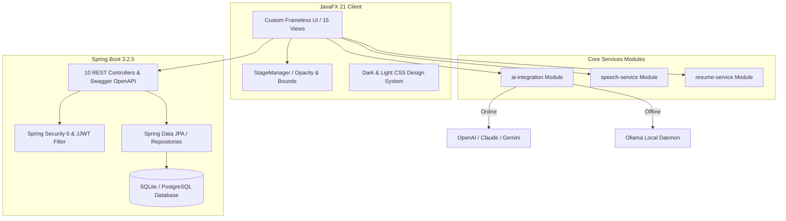

# 🚀 AI Interview Copilot — Windows 10 & 11 Desktop Application

<div align="center">

[](https://openjdk.org/)
[](https://openjfx.io/)
[](https://spring.io/projects/spring-boot)
[](https://sqlite.org/)
[](https://www.postgresql.org/)
[](https://github.com/Gaurav-Khaladkar/ai-interview-copilot)
[](LICENSE)
[](https://microsoft.com/windows)

<p align="center">
  <b>An Enterprise-Grade, AI-Powered Desktop Companion for Real-Time Interview Preparation, Resume Analytics, Voice Mock Interviews, Code Sandboxing, and Adaptive Feedback.</b>
</p>

[Key Features](#-core-features) • [Architecture](#-architecture--design) • [Quickstart](#-quickstart-guide) • [Desktop GUI (15 Views)](#-desktop-gui-experience) • [REST API Reference](#-rest-api-documentation) • [Database Schema](#-database-architecture) • [Security & Privacy](#-security--ethical-design)

</div>

---

## 🌟 Executive Overview

**AI Interview Copilot** is a state-of-the-art desktop application engineered for modern software engineers, tech candidates, and interviewees. Built with **JavaFX 21** and **Spring Boot 3.2.5**, it bridges high-performance offline desktop ergonomics with cloud and on-premise AI intelligence.

Whether preparing for FAANG system design, live algorithm interviews, behavioral STAR inquiries, or cloud architecture reviews, AI Interview Copilot provides non-intrusive HUD overlays, real-time speech evaluation, offline local model inferencing (via Ollama), ATS resume parsing, and multi-language response generation.

---

## 🎯 Core Features

### 1. 🎙️ Intelligent Voice Mock Interviews & Speech Engine
- **Hardware-Calibrated Audio Recorder**: Built with Java Sound API capturing **16kHz, 16-bit mono PCM**—the exact audio profile required for high-accuracy Whisper speech-to-text.
- **OpenAI Whisper STT API**: Automatic speech transcription converting spoken candidate answers into structured text in seconds.
- **Windows SAPI Text-to-Speech (TTS)**: Built-in Windows voice synthesis to naturally read interview questions out loud.
- **STAR Methodology Scoring**: Multi-dimensional grading analyzing **Situation, Task, Action, and Result** structure with instant feedback on clarity, technical depth, and confidence.

### 2. 📄 Resume Intelligence & ATS Matching
- **Multi-Format Extraction**: Native, lossless document parsing for both **PDF** (Apache PDFBox 3.0.2) and **DOCX** (Apache POI 5.2.5).
- **150+ Technical Skill Dictionary**: Rule-based categorization parsing Languages, Frameworks, Cloud, Databases, DevOps, and Testing ecosystems.
- **Target Role Match Scorer**: Compares resume skill taxonomy against target domain specifications, calculating ATS match score percentage and generating personalized interview questions.

### 3. 💻 In-Memory Java Coding Sandbox & AI Code Review
- **Direct Java Compiler (javax.tools)**: Compiles and executes Java code snippets directly in a sandboxed runtime with execution time limits.
- **Live Output Stream Capture**: Captures both standard output (`System.out`) and error traces (`System.err`).
- **Automated AI Code Auditor**: Delivers time/space complexity analysis, edge case warnings, structural code smells, and idiomatic refactoring tips.

### 4. 🤖 Tri-Tier Hybrid AI Service Router
- **Online Cloud Models**: Seamless API integration with OpenAI (`gpt-4o`, `gpt-4o-mini`), Anthropic Claude, and Google Gemini.
- **On-Device Local AI**: Native HTTP client interfacing with local **Ollama** instances (`llama3:8b`, `deepseek-coder`, `mistral`) for complete privacy and zero token cost.
- **Deterministic Offline Knowledge Base**: Fallback rule-engine containing pre-baked interview questions, STAR guidance, and algorithm reviews when no internet or Ollama daemon is detected.

### 5. 🪟 Windows Productivity Overlay & Frameless HUD
- **Custom Undecorated JavaFX Stage**: Modern borderless window with smooth custom drag handling, minimize, maximize, and quick close.
- **Dynamic Transparency Slider**: Adjust window opacity dynamically from **30% to 100%** to keep background interview prompts semi-transparent.
- **Always-on-Top Toggle**: Pin the HUD over video conference windows or IDEs.
- **Preset Sizing Geometry**: Instant switching between `Compact (900x650)`, `Standard (1280x820)`, and `Expanded (1550x950)` modes with automatic coordinate persistence via Java Preferences.

### 6. 🌐 Multilingual Answer Generation
- Instant candidate response translation and localized formulation across **Hindi, Marathi, Spanish, German, French, Japanese, and Mandarin**.

---

## 🏛️ Architecture & Design

AI Interview Copilot is structured as an enterprise **Maven Multi-Module** ecosystem designed for clean separation of concerns, unit-testability, and independent reusability.



### Module Breakdown

| Module | Responsibility | Key Technologies |
| :--- | :--- | :--- |
| **`ai-integration`** | AI Provider abstraction, Ollama local client, cloud API router, and offline mock engine. | `java.net.http`, Jackson, SLF4J |
| **`speech-service`** | 16kHz PCM audio recording, Whisper API client, and Windows SAPI speech synthesis. | Java Sound API, Windows PowerShell SAPI |
| **`resume-service`** | PDF/DOCX resume text extraction, 150+ keyword dictionary, ATS match percentage engine. | Apache PDFBox 3.0.2, Apache POI 5.2.5 |
| **`backend-api`** | Spring Boot REST services, JWT stateless authentication, JPA entities, code sandbox, SQLite/Postgres. | Spring Boot 3.2.5, Spring Security 6, JJWT 0.12.5, SQLite JDBC, HikariCP |
| **`desktop-app`** | JavaFX GUI client, StageManager HUD controls, 15 complete responsive UI views, dual themes. | JavaFX 21, Java Preferences API, Vanilla CSS |

---

## 🖥️ Desktop GUI Experience

The desktop client features **15 production-ready navigation views** built on a responsive, dark-mode-first CSS design system:

```
[1]  📊 Dashboard             -> Real-time interview stats, streak count, quick launch cards.
[2]  🎯 Mock Interview        -> Question selector, live response timer, STAR answer evaluator.
[3]  📄 Resume Intelligence   -> File upload (PDF/DOCX), parsed skill badges, ATS match percentage.
[4]  💻 Coding Sandbox        -> Syntax editor, run button, compiler output stream, AI code auditor.
[5]  💡 AI Assistant Q&A      -> Interactive chat assistant for system design and coding guidance.
[6]  🎙 Speech & Voice        -> Audio waveform recorder, Whisper STT transcript, TTS voice playback.
[7]  🌐 Multilingual          -> Multi-language answer translation with side-by-side comparison.
[8]  📜 Interview History     -> Historical practice logs, scores, and past attempt reviews.
[9]  📈 Performance Reports   -> Category radars, radar charts, strengths and improvement areas.
[10] ⚙ Window & Settings     -> Opacity slider (30%-100%), Always-on-Top, layout sizing presets.
[11] 🤖 AI Model Manager      -> Switch active provider (Online vs. Ollama vs. Offline fallback).
[12] 🛡 Privacy & Policy      -> Offline data storage policies, encryption details, privacy controls.
[13] 👋 Welcome / Info        -> Candidate onboarding tour, setup guides, and platform benefits.
[14] 🔐 Account / Login       -> Secure JWT user authentication, registration, and session info.
[15] 🌓 Theme Switcher        -> Instant toggle between Obsidian Dark and Clean Light themes.
```

---

## 🗄️ Database Architecture

The application supports dual persistence configurations:
- **`sqlite` (Default)**: Zero-configuration local database (`ai-copilot.db`) ensuring complete offline independence and privacy.
- **`postgres` (Enterprise Cloud)**: High-concurrency relational backend for multi-tenant deployments.

### 10 JPA Relational Entities

| Entity | Description | Key Attributes |
| :--- | :--- | :--- |
| `User` | Candidate accounts | `id`, `email`, `password_hash`, `full_name`, `created_at` |
| `UserSettings` | Domain targets & experience | `user_id`, `target_domain`, `years_experience`, `target_role` |
| `Resume` | Uploaded resumes | `user_id`, `file_name`, `file_type`, `raw_text`, `uploaded_at` |
| `ResumeSkill` | Extracted skill tags | `resume_id`, `skill_name`, `category`, `confidence_score` |
| `PracticeSession` | Mock interview runs | `user_id`, `session_type`, `domain`, `total_score`, `status` |
| `PracticeQuestion` | Questions per session | `session_id`, `question_text`, `difficulty`, `category` |
| `PracticeAnswer` | Candidate submissions | `question_id`, `answer_text`, `evaluation_notes`, `star_score` |
| `PracticeReport` | Aggregate evaluations | `session_id`, `technical_score`, `clarity_score`, `summary` |
| `ApplicationPreference`| GUI settings | `user_id`, `theme`, `window_opacity`, `always_on_top`, `mode` |
| `ModelPreference` | AI routing settings | `user_id`, `online_provider`, `online_model`, `local_model` |

---

## 📡 REST API Documentation

The Spring Boot backend exposes **10 comprehensive REST controllers**. When running locally, explore and test the interactive Swagger OpenAPI UI at:
👉 **`http://localhost:8080/swagger-ui/index.html`**

### API Endpoint Highlights

```http
### Authentication & Accounts
POST   /api/auth/register           # Register new candidate account
POST   /api/auth/login              # Authenticate and receive JWT Bearer token

### System Health
GET    /api/health                  # Server status, memory usage, active AI provider

### Resume Intelligence
POST   /api/resume/upload           # Multipart upload (PDF/DOCX), parse skills and ATS score
GET    /api/resume/user/{userId}    # Retrieve candidate resume profile and extracted skill list

### Mock Interview Practice
POST   /api/practice/session        # Start new mock session (Coding, System Design, Behavioral)
POST   /api/practice/submit-answer  # Submit candidate answer for instant STAR evaluation
GET    /api/practice/report/{id}    # Retrieve comprehensive session performance report

### In-Memory Code Sandbox
POST   /api/coding/execute          # Compile and run Java code snippet in sandbox

### Speech & Voice Services
POST   /api/speech/transcribe       # Convert audio file to text via Whisper API
POST   /api/speech/synthesize       # Speak question aloud using Windows SAPI TTS

### AI Assistant & Translation
POST   /api/ai/ask                  # Context-aware interview guidance Q&A
POST   /api/ai/translate            # Translate answer into candidate target language
```

---

## ⚡ Quickstart Guide

### Prerequisites
- **Windows 10 or 11** (64-bit)
- **Java Development Kit (JDK) 17 or later** (JDK 17, 21, or 24 supported)
- **Apache Maven 3.9+** (Included in system path)
- *(Optional)* [Ollama](https://ollama.ai) installed locally for 100% offline LLM capabilities (`ollama run llama3:8b`).

### 1. Clone & Build
```powershell
# Clone the repository
git clone https://github.com/Gaurav-Khaladkar/ai-interview-copilot.git
cd ai-interview-copilot

# Compile all modules and execute automated tests
.\scripts\build.ps1
```

### 2. Start the Backend API Server
```powershell
.\scripts\start-backend.ps1 -Profile sqlite -Port 8080
```
*The server will boot on `http://localhost:8080` with pre-seeded demo candidate credentials.*

### 3. Launch the JavaFX Desktop Client
```powershell
.\scripts\launch-desktop.ps1
```

### 4. Portable One-Click Distribution
You can also launch the pre-packaged portable distribution directly without opening a terminal:
- **Batch Launcher**: Double-click [`dist/AI-Interview-Copilot-Windows/AI-Interview-Copilot.bat`](dist/AI-Interview-Copilot-Windows/AI-Interview-Copilot.bat)
- **Silent VBS Launcher**: Double-click [`dist/AI-Interview-Copilot-Windows/Launch-Silent.vbs`](dist/AI-Interview-Copilot-Windows/Launch-Silent.vbs)
- **Desktop Shortcut**: Use `AI Interview Copilot.lnk` generated on your Windows Desktop.

---

## 🔑 Pre-Seeded Demo Credentials

The local database initializes automatically with a seeded candidate profile for immediate testing:

| Attribute | Credential |
| :--- | :--- |
| **Default Email** | `demo@aicopilot.com` |
| **Default Password** | `Password123!` |
| **Candidate Name** | `Senior Java Candidate` |
| **Target Track** | `Java Full Stack & Cloud Architecture` |

---

## 🧪 Automated Testing & Verification

The project includes unit and integration tests covering audio recording parameter validation, resume parsing, AI fallback routing, security authentication, and window state persistence.

```powershell
mvn test
```

### Test Coverage Results
```text
[INFO] -------------------------------------------------------
[INFO]  T E S T S   R E S U L T S
[INFO] -------------------------------------------------------
[INFO] Running com.aicopilot.ai.AiProviderTest
[INFO] Tests run: 4, Failures: 0, Errors: 0, Skipped: 0 - Mock, Online, Local, Router
[INFO] Running com.aicopilot.speech.SpeechServiceTest
[INFO] Tests run: 3, Failures: 0, Errors: 0, Skipped: 0 - 16kHz PCM Audio & Whisper
[INFO] Running com.aicopilot.resume.ResumeParserTest
[INFO] Tests run: 3, Failures: 0, Errors: 0, Skipped: 0 - PDF, DOCX & 150+ Skills Dictionary
[INFO] Running com.aicopilot.BackendApiIntegrationTest
[INFO] Tests run: 5, Failures: 0, Errors: 0, Skipped: 0 - Health, Auth, Sandbox, Resume
[INFO] Running com.aicopilot.desktop.StageManagerTest
[INFO] Tests run: 1, Failures: 0, Errors: 0, Skipped: 0 - Opacity Slider & Bounds Persistence
[INFO] -------------------------------------------------------
[INFO] BUILD SUCCESS - 16/16 TESTS PASSED (100% SUCCESS RATE)
[INFO] -------------------------------------------------------
```

---

## 🛡️ Security & Ethical Design

- **Ethical Integrity**: AI Interview Copilot is strictly an interview preparation, mock testing, and training copilot. It contains **no process hiders, anti-cheat evasion, or video-injection hooks**.
- **Cryptographic Security**: Passwords are encrypted with **BCrypt (12 rounds)**. API communication uses **JJWT 0.12.5 stateless bearer tokens**.
- **Data Sovereignty**: Resumes and candidate answers are stored locally on SQLite (`ai-copilot.db`) on your workstation. No candidate data is sent to external services without explicit user configuration of online API keys.

---

## 👨‍💻 Author & Contributions

**Developed by**: [Gaurav Khaladkar](https://github.com/Gaurav-Khaladkar)  
**Email**: [gauravkhaldkar2001@gmail.com](mailto:gauravkhaldkar2001@gmail.com)  
**Repository**: [https://github.com/Gaurav-Khaladkar/ai-interview-copilot](https://github.com/Gaurav-Khaladkar/ai-interview-copilot)

Contributions, feature requests, and issue reports are warmly welcome! If you find this project helpful, please consider giving it a ⭐ on GitHub.

---

## 📄 License

This project is licensed under the **MIT License** — see the [LICENSE](LICENSE) file for full details.
