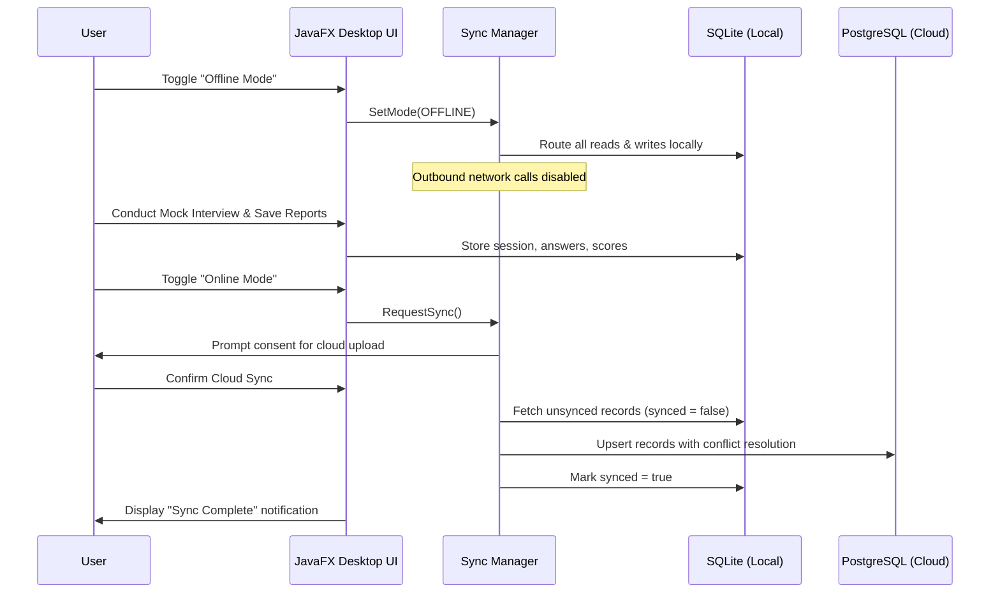

# System Architecture & Design Specification
## Project: AI Interview Copilot
### Windows 10/11 Desktop Application

---

## 1. High-Level Modular Decomposition

The project is structured as an enterprise-grade multi-module Java application:

```
ai-interview-copilot/
├── pom.xml                        # Root Parent POM (Dependency & Plugin Management)
├── backend-api/                   # Spring Boot 3 REST API Server & Data Layer
│   ├── src/main/java/             # Spring Security, JWT, Controllers, Entities, Repositories, DTOs
│   ├── src/main/resources/        # application.yml, application-sqlite.yml, application-postgres.yml
│   └── src/test/java/             # MockMvc API tests, JPA integration tests
├── ai-integration/                # LLM Abstraction Layer
│   ├── src/main/java/             # AiService interface, OnlineAiProvider, LocalAiProvider, MockAiProvider, PromptTemplates
│   └── src/test/java/             # AI Provider unit & offline isolation tests
├── resume-service/                # Document Analysis & Skill Extraction
│   ├── src/main/java/             # PDFBox parser, POI DOCX parser, SkillDictionary, ResumeIntelligenceService
│   └── src/test/java/             # Resume parsing & scoring unit tests
├── speech-service/                # Voice Recording & Transcription
│   ├── src/main/java/             # AudioRecorder (Java Sound API), WhisperClient, OfflineSpeechSimulator
│   └── src/test/java/             # Audio capture & transcription tests
├── desktop-app/                   # Modern JavaFX Desktop GUI
│   ├── src/main/java/             # JavaFX Application, StageController, NavigationRouter, ViewControllers
│   ├── src/main/resources/fxml/   # 15 FXML view definitions
│   ├── src/main/resources/styles/ # Dark & Light Theme modern CSS design system
│   └── src/test/java/             # Window customization & UI lifecycle tests
├── database/                      # Schema and migration assets
│   ├── migrations/                # PostgreSQL & SQLite DDL scripts
│   └── seeds/                     # Initial seed data for skills, questions, and system settings
├── documentation/                 # SRS, Architecture, UML, User Guides, Manuals
├── scripts/                       # Windows PowerShell & Batch build, run, package scripts
└── tests/                         # End-to-end integration test suites
```

---

## 2. Component Design & Responsibilities

### 2.1 Backend API Layer (`backend-api`)
- **Technology**: Spring Boot 3.2+, Spring Data JPA, Spring Security 6, JJWT (Java JWT).
- **Embedded Application Engine**: Can run as an independent background daemon or co-hosted within the desktop JVM process.
- **Security & Session**:
  - Stateless JWT token filtering on `/api/**` (except `/api/auth/**`, `/api/health`, `/swagger-ui/**`).
  - Passwords hashed with BCrypt (strength 12).
- **Data Repositories**:
  - Dual database driver support:
    - Default `sqlite` profile for completely offline local file persistence (`ai-copilot.db`).
    - Optional `postgres` profile for enterprise team deployments.

### 2.2 AI Service Architecture (`ai-integration`)
- Implements the Strategy Pattern via `AiProvider` interface:
  ```java
  public interface AiProvider {
      AiResponse generateAnswer(AiPromptRequest request);
      List<String> generateQuestions(ResumeSkills skills, String domain, String level);
      EvaluationReport evaluateAnswer(PracticeAnswerSubmission submission);
      CodeAnalysisReport analyzeCode(CodeExecutionSubmission submission);
      String translate(String text, String targetLanguage);
      boolean isHealthy();
      String getProviderName();
  }
  ```
- **Implementations**:
  - `OnlineAiProvider`: Connects to OpenAI-compatible REST endpoints (including Gemini via OpenAI adapter or Claude) with exponential backoff and timeout safeguards.
  - `LocalAiProvider`: Connects to local running Ollama (`http://localhost:11434/api/generate`) or local llama.cpp servers without hitting the external internet.
  - `MockAiProvider`: Fully self-contained offline heuristic engine containing comprehensive question banks, concept breakdowns, and multilingual translations. Operates with zero network and zero external dependencies.

### 2.3 Resume Intelligence Service (`resume-service`)
- `PdfResumeParser`: Uses Apache PDFBox 3.x to stream and parse complex layouts, multi-column headers, and bulleted lists.
- `DocxResumeParser`: Uses Apache POI 5.x to extract text, tables, and formatting from Microsoft Word documents.
- `SkillExtractor`: Regular expression and dictionary tokenization across 10 technology categories:
  - Languages (Java, Python, C++, TypeScript, Go, etc.)
  - Frameworks (Spring Boot, React, Angular, Django, etc.)
  - Databases (PostgreSQL, MySQL, MongoDB, Redis, SQLite)
  - Cloud & DevOps (AWS, Azure, Docker, Kubernetes, CI/CD)
  - Architecture (Microservices, REST, Kafka, System Design)

### 2.4 Voice & Audio Service (`speech-service`)
- `AudioRecorder`: Captures 16,000 Hz, 16-bit, mono PCM audio using standard Java `TargetDataLine` without requiring external C/C++ native binaries.
- `WhisperTranscriptionService`: Submits recorded WAV files to Whisper-compatible transcription endpoints.
- `OfflineSpeechSimulator`: Provides instant offline phoneme matching and sample transcription verification when offline mode is active.

### 2.5 Desktop UI Layer (`desktop-app`)
- **JavaFX 21** with CSS variables, smooth transitions, and modern typography.
- **Window Customization API**:
  - `Stage.setOpacity(double value)`: Bound to a live UI slider for 30% to 100% transparency.
  - `Stage.setAlwaysOnTop(boolean value)`: Pinned window mode for multitasking.
  - Custom frameless title bar with drag handler, maximize bounds calculation, and multi-monitor DPI scaling.

---

## 3. Online/Offline Synchronization Model



---

## 4. Security, Isolation & Proctoring Compatibility
1. **Host Safety**: Candidate code runs through strict safety checks (AST inspection, memory ceiling, execution timeout of 5 seconds) to prevent infinite loops or system calls.
2. **Standard Desktop Footprint**: The application registers as a standard user-space window process (`AI Interview Copilot`).
3. **No Invasive Hooks**: Does not hook into keyboard drivers, screen scraping hooks, or system DLLs. Fully transparent and compliant with corporate and assessment environment standards.
