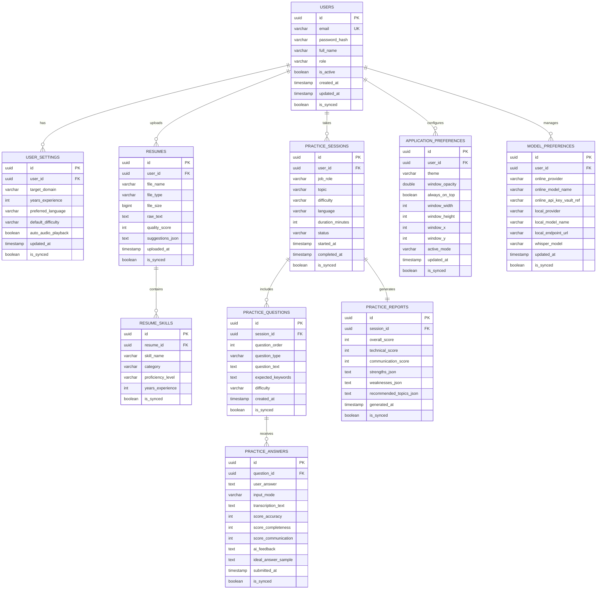

# Database Design & Entity Relationship Specification
## Project: AI Interview Copilot

---

## 1. Entity-Relationship Overview

The database supports both PostgreSQL (online/cloud) and SQLite (offline/local). All table definitions and column constraints are designed for dual compatibility.

---

## 2. Table Specifications & Indexes

1. **`users`**:
   - `id`: VARCHAR(36) / UUID PRIMARY KEY.
   - `email`: VARCHAR(255) NOT NULL UNIQUE (B-Tree Index).
   - `password_hash`: VARCHAR(255) NOT NULL (BCrypt hash).
   - `full_name`: VARCHAR(150) NOT NULL.
   - `role`: VARCHAR(50) DEFAULT 'ROLE_CANDIDATE'.
   - `is_active`: BOOLEAN DEFAULT TRUE.
   - `created_at`, `updated_at`: TIMESTAMP.
   - `is_synced`: BOOLEAN DEFAULT FALSE.

2. **`user_settings`**:
   - `user_id`: Foreign Key referencing `users(id)` ON DELETE CASCADE.
   - Target domain indexing for performance analysis.

3. **`resumes` & `resume_skills`**:
   - Foreign key cascading on resume deletion.
   - Index on `(resume_id, skill_name)`.

4. **`practice_sessions`, `practice_questions`, `practice_answers`, `practice_reports`**:
   - Composite index on `(user_id, started_at)` for fast history lookups.
   - `is_synced` column on all persistent records to facilitate offline-to-cloud bidirectional synchronization.
