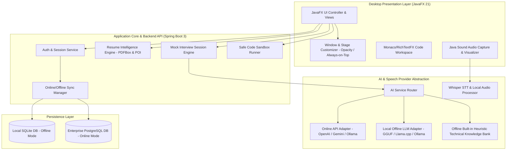

# Software Requirements Specification (SRS)
## Project Name: AI Interview Copilot
### Platform: Windows 10 & Windows 11 Desktop Application
### Version: 1.0.0
### Organization: Mentore Solution

---

## 1. Introduction

### 1.1 Purpose
The **AI Interview Copilot** is an enterprise-grade Windows desktop application built with JavaFX and Spring Boot. It empowers job seekers and professionals to prepare for technical and behavioral interviews through AI-assisted mock interviews, intelligent resume parsing, voice interaction with Whisper-compatible speech recognition, multi-language translation, coding practice in an isolated sandbox, and dual online/offline execution modes.

### 1.2 Scope
- **Target OS**: Windows 10 (Build 19041+) and Windows 11 (64-bit).
- **Core Capabilities**:
  1. Secure authentication (JWT, BCrypt) and local/cloud user profiles.
  2. Multi-format resume extraction (PDF, DOCX) with skills discovery and question generation.
  3. Interactive interview workspace with short/detailed answers, code line-by-line breakdown, and concept cards.
  4. Multilingual generation & translation (English, Hindi, Marathi, and configurable locales).
  5. Audio capture, microphone permission diagnostics, Whisper STT integration, and offline speech emulation.
  6. Dynamic mock interview system with real-time scoring, topic analysis, and performance analytics.
  7. Multi-language code editor (Java, Python, JavaScript, SQL) with test case execution and isolated sandboxing.
  8. Seamless Online/Offline dual mode with SQLite local caching, zero-leak offline isolation, and cloud PostgreSQL synchronization.
  9. Advanced Windows Stage customization: adjustable opacity (30% to 100%), always-on-top, custom frameless controls, and monitor management.
  10. Strict ethical and security adherence: non-invasive desktop presence, zero proctoring bypass/evasion, transparent sandboxed execution.

---

## 2. Overall Description

### 2.1 System Architecture

---

## 3. Specific Functional Requirements (FR)

### Module A: Authentication & User Profile
- **FR-AUTH-01**: User registration with email, full name, encrypted password (BCrypt with strength 12), and role selection.
- **FR-AUTH-02**: JWT token generation with 24-hour expiration for online mode; local session token for offline SQLite mode.
- **FR-AUTH-03**: Password complexity enforcement (minimum 8 characters, uppercase, lowercase, digit, special character).
- **FR-AUTH-04**: User profile update (target domain, years of experience, preferred languages, default interview difficulty).
- **FR-AUTH-05**: Secure session termination and credential cleanup upon logout.

### Module B: Resume Intelligence Engine
- **FR-RES-01**: Support uploading PDF files (via Apache PDFBox) and DOCX files (via Apache POI).
- **FR-RES-02**: Enforce maximum file size limit of 10 MB and validate MIME types.
- **FR-RES-03**: Extract technical competencies matching 150+ technology keywords (Java, Spring, Python, Docker, Kubernetes, SQL, AWS, React, etc.).
- **FR-RES-04**: Extract candidate education, certifications, and project experience without hallucinatory additions.
- **FR-RES-05**: Generate tailored interview questions directly mapped to verified resume skills.
- **FR-RES-06**: Compute a Resume Quality Score (0-100) and actionable bullet-point recommendations.
- **FR-RES-07**: Allow preview, JSON export, and complete data deletion.

### Module C: AI Interview Assistant & Knowledge Base
- **FR-AI-01**: Dual response length: "Short & Crisp (1-2 mins)" and "In-Depth Architectural (3-5 mins)".
- **FR-AI-02**: Code generation with step-by-step and line-by-line explanations.
- **FR-AI-03**: Support domains: Core Java, Spring Boot, Python, JavaScript, SQL, Android, Systems/OS, Cloud & Microservices.
- **FR-AI-04**: Follow-up question generation simulating realistic interviewer depth.
- **FR-AI-05**: Interactive chat history persistence with timestamping and topic tagging.

### Module D: Multilingual Processing
- **FR-LANG-01**: First-class support for English, Hindi (हिंदी), and Marathi (मराठी).
- **FR-LANG-02**: Instant translation of technical terms with contextual transliteration.
- **FR-LANG-03**: Auto-fallback notification when offline local models lack specific language vocabulary.
- **FR-LANG-04**: Language preference persistence in local preferences.

### Module E: Voice Input & Speech Services
- **FR-VOX-01**: Hardware microphone device discovery, permission validation, and audio level metering.
- **FR-VOX-02**: 16kHz 16-bit mono PCM WAV recording for optimal Whisper transcription.
- **FR-VOX-03**: Real-time transcription preview modal allowing candidate edits before AI submission.
- **FR-VOX-04**: Offline speech recognition simulation and local fallback STT.
- **FR-VOX-05**: Audio privacy controls (zero background recording without explicit recording state).

### Module F: Mock Interview Simulator
- **FR-MOCK-01**: Configuration of Job Role, Topic, Difficulty (Junior, Mid, Senior, Lead), Duration (15-60 min).
- **FR-MOCK-02**: Mixed technical (70%) and behavioral/scenario (30%) question delivery.
- **FR-MOCK-03**: Candidate response evaluation across 4 dimensions: Technical Accuracy, Completeness, Structure, and Communication.
- **FR-MOCK-04**: Generation of comprehensive Session Report Card with radar chart metrics and strengths/weaknesses.

### Module G: Sandboxed Coding Practice
- **FR-CODE-01**: Integrated code editor with keyword syntax highlighting for Java, Python, JavaScript, and SQL.
- **FR-CODE-02**: Problem repository with starter code, problem description, time complexity goals, and test cases.
- **FR-CODE-03**: Sandboxed execution engine with strict CPU timeout (5000ms), memory limits (256MB), and disallowed syscalls.
- **FR-CODE-04**: AI-powered code analysis: bug discovery, time complexity Big-O estimation, and optimal refactoring suggestions.

### Module H: Dual Online/Offline Operation & Model Management
- **FR-SYNC-01**: Prominent top-level status bar toggle between Online and Offline modes.
- **FR-SYNC-02**: Guaranteed network silence in Offline mode (no outbound HTTP/HTTPS requests).
- **FR-SYNC-03**: Model manager screen displaying local LLM models (e.g., Llama-3-8B-Q4, Phi-3, Mistral, Whisper-base), VRAM/RAM specs, file size, and download instructions.
- **FR-SYNC-04**: SQLite local database storing all sessions, resumes, and offline questions.
- **FR-SYNC-05**: Explicit user-consented synchronization when transitioning from Offline to Online.

### Module I: Desktop Stage & Window Customization
- **FR-WIN-01**: Frameless custom title bar with drag-to-move, minimize, maximize/restore, and close.
- **FR-WIN-02**: Opacity slider dynamically adjusting Stage opacity from 30% to 100% (`Stage.setOpacity()`).
- **FR-WIN-03**: "Always on Top" toggle pinned mode (`Stage.setAlwaysOnTop()`).
- **FR-WIN-04**: Multi-monitor DPI awareness and position saving across reboots.
- **FR-WIN-05**: Light and Dark mode theme switching with instant CSS restyling.

### Module J: Third-Party Compatibility & Ethical Guardrails
- **FR-SEC-01**: Full compliance with operating system security standards; no kernel hooks or process disguise.
- **FR-SEC-02**: Transparent self-identification in Windows Task Manager as `AI Interview Copilot`.
- **FR-SEC-03**: Clear user declaration that the tool is intended for preparation and mock interviews, not for live assessment evasion.

---

## 4. Non-Functional Requirements (NFR)

1. **Performance**: UI responsiveness under 16ms per frame (60 FPS). Resume parsing under 1.5 seconds for files up to 10MB.
2. **Reliability**: Graceful offline fallback without uncaught exceptions. Zero crashes when offline models are missing or network drops.
3. **Security**: OWASP Top 10 compliance for REST endpoints, secure BCrypt password storage, encrypted local API key vault, sanitized code sandbox.
4. **Portability**: Windows 10/11 standalone MSI / EXE distribution with bundled JRE 17+.
